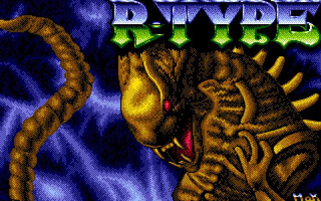
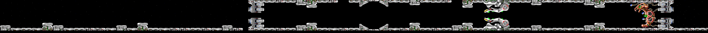

# R-Type – Amiga

Reverse-engineering and annotated disassembly of the Amiga **R-Type** (Electric Dreams, 1989; Amiga version by Factor 5, produced by Rainbow Arts). The aim is to learn how the game was put together.



| Folder | Contents |
|---|---|
| [`original/`](original/) | Byte-identical, annotated disassembly of the original disk, the extraction tools and documentation |

Documentation is in [`original/docs/`](original/docs/README.md):

- [DISK_FORMAT.md](original/docs/DISK_FORMAT.md) – disk, track formats, boot process, loaders
- [GAME.md](original/docs/GAME.md) – how the program is organised
- [DATA_FORMATS.md](original/docs/DATA_FORMATS.md) – levels, checkpoints, waves, scrolling, objects
- [GRAPHICS.md](original/docs/GRAPHICS.md) – screen layout, tiles, map, BOBs, sprites
- [MUSIC.md](original/docs/MUSIC.md) – TFMX title music and the in-game sequencer

The same findings are added as comments in the source files. What's left is listed in [TODO.md](original/docs/TODO.md).

## Graphics




Stage 1's full map and the R-9's tilt frames, rendered straight from the disk data. See [`original/gfx/`](original/gfx/) for all eight levels, their tile sets and enemies.

## Progress

- [x] IPF decoded, all files extracted with checksums verified
- [x] Bootblock – [`original/src/bootblock.s`](original/src/bootblock.s)
- [x] Stage-2 loader / credits – [`original/src/stage2.s`](original/src/stage2.s)
- [x] Game program – [`original/src/game.s`](original/src/game.s): first pass, byte-identical, code and data separated, main systems named
- [ ] Game program: line-by-line comments
- [x] Level code – [`original/src/levels/`](original/src/levels/) (8 levels) and the shared title file [`original/src/shared.s`](original/src/shared.s): first pass, byte-identical
- [ ] Level code: name enemy routines and object definitions
- [x] Documented: disk, code structure, data, graphics and music formats (first pass)
- [x] Graphics extracted to PNG: all level maps, tile sets, enemy frames and the player sprites ([`original/gfx/`](original/gfx/))
- [x] Sound effects decoded and extracted to WAV ([`original/sfx/`](original/sfx/)); `$6000` block mapped
- [x] Object definitions labelled in all sources (`Def_`/`Upd_`/`Spawn_`)
- [x] In-game music tables located for all 9 players, samples extracted ([`original/music/`](original/music/)); object gallery ([OBJECTS.md](original/docs/OBJECTS.md))
- [ ] Still open: see [TODO.md](original/docs/TODO.md) (object names, line-by-line comments, song tables, disk rebuild…)

## Game data

All files extracted from the disk are in [`original/files/`](original/files/) (see `manifest.json` for load addresses, tracks and SHA-1s). To regenerate them from a disk image and check the sources:

```sh
python3 -I original/tools/extract.py path/to/R-Type.ipf original/files/
python3 -I original/tools/verify.py      # needs vasmm68k_mot
```
