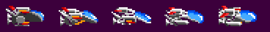

# R-Type – Amiga

[](https://github.com/MarkyTurtle/R-Type---Amiga/actions/workflows/build.yml)

Reverse-engineering and annotated disassembly of the Amiga **R-Type** (Electric Dreams, 1989; Amiga version by Factor 5, produced by Rainbow Arts). The aim is to learn how the game was put together.


| Folder | Contents |
|---|---|
| [`original/`](original/) | Byte-identical, annotated disassembly of the original disk, the extraction tools and documentation |

Documentation is in [`original/docs/`](original/docs/README.md):

- [DISK_FORMAT.md](original/docs/DISK_FORMAT.md) – disk, track formats, boot process, loaders
- [GAME.md](original/docs/GAME.md) – how the program is organised
- [DATA_FORMATS.md](original/docs/DATA_FORMATS.md) – levels, checkpoints, waves, scrolling, objects
- [GRAPHICS.md](original/docs/GRAPHICS.md) – screen layout, tiles, map, BOBs, sprites
- [MUSIC.md](original/docs/MUSIC.md) – TFMX title music and the in-game sequencer
- [OBJECTS.md](original/docs/OBJECTS.md) – every enemy and object, with pictures

The same findings are added as comments in the source files. What's left is listed in [TODO.md](original/docs/TODO.md).

## Graphics




Stage 1's full map and the R-9's tilt frames, rendered straight from the disk data. See [`original/gfx/`](original/gfx/) for all eight levels, their tile sets and enemies.

## Progress

- [x] IPF decoded, all files extracted with checksums verified
- [x] Bootblock – [`original/src/bootblock.s`](original/src/bootblock.s)
- [x] Stage-2 loader / credits – [`original/src/stage2.s`](original/src/stage2.s)
- [x] Game program – [`original/src/game.s`](original/src/game.s): byte-identical, every label named, every routine commented
- [x] Level code – [`original/src/levels/`](original/src/levels/) (8 levels): every enemy and boss named after the arcade's and commented line by line
- [x] Shared title file and jingle player – [`original/src/shared.s`](original/src/shared.s); the TFMX title-music replay – [`original/src/tfmx.s`](original/src/tfmx.s)
- [x] Documented: disk, code structure, data, graphics and music formats; object gallery ([OBJECTS.md](original/docs/OBJECTS.md))
- [x] Graphics extracted to PNG ([`original/gfx/`](original/gfx/)), sound effects and instrument samples to WAV ([`original/sfx/`](original/sfx/), [`original/music/`](original/music/))
- [x] All the music rendered by running the game's own player code in a 68000 emulator ([`original/music/songs/`](original/music/songs/README.md))
- [x] Disk rebuild: an extended ADF built from the sources, booted in WinUAE and level 1 played
- [ ] Still open: high-score saving on the rebuilt disk, a full play-through, and the enhanced version (cheat mode, AmigaDOS disk, faster display) – see [TODO.md](original/docs/TODO.md)

## Game data

All files extracted from the disk are in [`original/files/`](original/files/) (see `manifest.json` for load addresses, tracks and SHA-1s). To regenerate them from a disk image and check the sources:

```sh
python3 -I original/tools/extract.py path/to/R-Type.ipf original/files/
python3 -I original/tools/verify.py      # needs vasmm68k_mot

# rebuild a bootable disk image (WinUAE extended ADF) from the sources
VASM=vasmm68k_mot python3 -I original/tools/build_disk.py --from-source R-Type.adf
```

The same is done on every push by a GitHub Action (`.github/workflows/build.yml`): it builds vasm, checks that all 13 sources assemble byte-identical, builds `R-Type.adf` from the sources and attaches it to the run as an artifact (*Actions* → the run → *Artifacts*).
