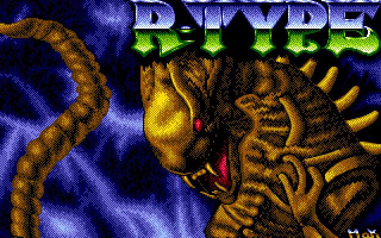

# R-Type (Amiga) – disassembly

Reverse-engineering of the Amiga R-Type (Electric Dreams 1989; Amiga version by Factor 5, produced by Rainbow Arts), set up the same way as the Ghosts'n Goblins and New Zealand Story projects.



## Status

- [x] IPF decoded; all files extracted with checksums verified (`files/`, `files/manifest.json`)
- [x] Bootblock disassembled and annotated – `src/bootblock.s`, byte-identical
- [x] Stage-2 loader / credits sequence disassembled and annotated – `src/stage2.s`, byte-identical
- [x] Disk formats, game loader, track cache, decruncher and level table documented – `docs/DISK_FORMAT.md`
- [ ] Game low code (`game_low_000a4.bin`, $A4–$5DE3)
- [ ] Game main code (`game_main_06000.bin`, $6000–$2D56F)
- [ ] Level data formats (`levelN_a`, `levelN_b` decrunched)

## Layout

```
src/bootblock.s        annotated bootblock
src/stage2.s           annotated stage-2 loader ($79360)
files/                 extracted disk files (not in git - run extract.py);
                       manifest.json lists names, load addresses, SHA-1s
docs/DISK_FORMAT.md    track formats, boot sequence, level table, memory map
tools/
  ipf2mfm.py           IPF -> raw MFM bitstreams per track
  mfmlib.py            MFM helpers + AmigaDOS sector decoder
  extract.py           IPF -> files/  (runs ipf2mfm, decodes all three formats,
                       verifies every checksum, decrunches the levels)
  decrunch.py          exact Python port of the game's decruncher at $3EFC
  verify.py            assemble src/*.s and compare with files/
  dis68k.py            quick capstone listing of any region
  bootstrap_source.py  one-off first-pass source generator (not part of the build)
```

## Use

```sh
pip install capstone                                  # for dis68k / bootstrap only
python3 -I tools/extract.py path/to/R-Type.ipf files/
python3 -I tools/verify.py                            # needs vasmm68k_mot (or VASM=...);
                                                      # checks against manifest SHA-1s
```

The sources are hand-edited and read directly; there is no generation step. Assemble with:

```
vasmm68k_mot -Fbin -m68000 -no-opt -o bootblock.bin src/bootblock.s
```
