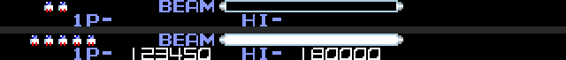

# R-Type (Amiga) – graphics formats

All findings come from the drawing code in `src/game.s`. The same notes are in the source as comments (see `SetBitplanes`, `DrawMap`, `ObjAnimDraw`, `CopperInt`, `CopperList`).

## Playfield

| | |
|---|---|
| Depth | 4 bitplanes, 16 colours (COLOR00–15 from the level palette) |
| Layout | **interleaved**: each line holds plane 0, 1, 2, 3, each **52 bytes** (416 px) → `$D0` bytes per line |
| Visible | 320 × 192 (DIWSTRT `$2C91`, DDFSTRT `$38`, lines `$2C`–`$EB`) |
| Modulo | BPL1MOD = BPL2MOD = `$A8` (3 × 52 + 52 − 40) |
| Buffers | `SCREEN_A` `$2D1BA`, `SCREEN_B` `$3AEBA`, 272 lines each (`$DD00` bytes) |
| View origin | buffer + `$1A06` (32 lines down, 6 bytes in) + FineScrollY lines |
| Scrolling | coarse = map column/row drawn first; fine = BPLCON1 (x) and a line offset (y, 0–15) |

The extra 96 pixels per line and 32 lines on top are margin: the 20 × 13 tile background is redrawn in full every frame (`DrawMap`), and BOBs can be clipped by simply drawing into the margin (x range −16…`$170`).

**Double buffering:** the game draws into `DrawBuffer`, and the copper interrupt (`SwapScreens` → `SetBitplanes`) switches the bitplane pointers once `FrameReady` is set and `FlipCountdown` has run out. The countdown is reloaded with 0 when `Flip50Hz` is set (title and high-score screens, 50 Hz) or 1 during play (25 Hz); see GAME.md, *Frame pacing*.

## HUD

From line `$ED` the copper switches to **3 bitplanes** (BPLCON0 `$3200`), non-interleaved 40-byte lines: planes at `$2C7B0`, `$2CA08`, `$2CC60` (`$258` bytes = 15 lines each), at the end of the `$6000` graphics block. Its colours are set by the copper list: COLOR02–07 `$999 $ACD $FFF $89F $00C $E00`, and COLOR01 changes on lines `$EE`–`$F3` (`$006 $00A $00E $00A $006 $FFF`), a blue gradient for everything drawn in plane 0.

The labels ("1P-", "BEAM", "HI-") and the meter's frame are part of the planes. The game writes into them directly:

| What | Routine | Address | Size | Planes |
|---|---|---|---|---|
| Lives | `DrawLives` | `$2C7DA` (line 1, x 16) | up to 5 icons of 8×6 (`LifeIcon`), Lives + 1 shown | 3 |
| Beam meter | `DrawBeamMeter` | `$2C7E8` (line 1, x 128) | 96×5: three longs of pixels (`ChargeBeam`) | 0 |
| Score | `DrawDigits` | `$2C8F9` (line 8, x 72) | 6 digits, 8×7 (`DigitFont`), leading zeros blank | 0 |
| Best score | `DrawDigits` | `$2C905` (line 8, x 168) | 6 digits (`TopScore`) | 0 |

`DigitFont` (in `game.s`) is 7 rows of 10 bytes, one byte per digit per row:

## Text font

`DrawChar` prints 8×8 characters from `$2CEB8`: 48 characters (in `CharSet` order: a–z, 0–9, `. , - _ ! ?` and a few symbols), 8 bytes each, plane 0 then plane 1 `$180` bytes later. They go into planes 0 and 1 of both screens (planes 2–3 cleared), so with `TextPalette` the text uses colours 1–3.

## Tiles

`LV_Tiles` (the start of level B, `$4D300`): **16 × 16 pixels, 4 interleaved planes = 128 bytes** (64 words: line 0 plane 0–3, line 1 …). Tile n is at `LV_Tiles + n × 128`. `DrawMap` copies each one with a single A→D blit (BLTSIZE `$1001`, D modulo `$32`).

## Map

`LV_Map`: one word per cell, row-major, `MapRowBytes` bytes per row (from `LevelTable`; the value is in bytes, not cells), row pointers at `$48BFA` (up to 26 rows).

| Bits | Meaning |
|---|---|
| 0–11 | tile number |
| 12 | destructible: shots, the Force, the Bits, the shot streams and the anti-air laser clear the cell to 0; the wave beam clears it and carries on. Some level objects (level 4) clear such cells too. |
| 13 | hit: set by shots, the wave beam, the lasers, the Force and the Bits when they touch the cell. The tile routine reads it: level 1's Blasters clear themselves and their neighbour when hit. |
| 14 | animated tile: bits 0–3 select a routine in `LV_TileAnims` (called while drawing). A solid animated cell stops the reflect laser without a bounce, and the wave beam passes through it. |
| 15 | solid: `GetMapCell` tests it (bit 7 of the high byte). The ship, the Force, the POW Armor, shots, lasers and the Bits collide with solid cells. |

`gfx/levelN_flags.png` shows each map with its flags: red = solid, yellow = destructible, cyan = animated (with level 1's Blasters, which the map patches add at level start). Destructible cells only occur in level 4 (the cell walls that Cytron builds and Geld eats); level 5's map has no solid cells at all.

Map sizes (tiles): level 1 268 × 13, 2 180 × 13, 3 68 × 26 (the giant battleship: the map is the ship itself), 4 172 × 13, 5 210 × 13, 6 164 × 13, 7 154 × 13, 8 187 × 13. Rendered in full in `gfx/levelN_map.png`.

## BOBs (enemies, shots, explosions)

Drawn with the blitter, cookie-cut, minterm `$CA` (D = A·B + ¬A·C; A = mask, B = graphics, C = background), with A/B shift from x & 15. The data is **interleaved like the screen**: each line holds plane 0–3 of the frame, with one extra word of width for the shift. The **mask** follows the graphics (definition `+$10`) and holds the one-plane mask repeated for each plane line. While an object's hit-flash bit is set, the mask is also used as B, so the whole shape is drawn in colour 15.

The object definition fields that drawing uses (full list in `docs/DATA_FORMATS.md`): `+$00` BLTSIZE, `+$02` C/D modulo, `+$04` bytes per frame, `+$0C` graphics, `+$10` mask offset, `+$14` animation sequence, `+$18` hit boxes.

Example, level 1 definition at `$4BB64`: BLTSIZE `$0D02` (52 lines = 13 × 4 planes, 2 words), modulo `$30`, frame `$D0` bytes (`$68` graphics + `$68` mask), graphics `$6A6D8` (level B).

## Hardware sprites

The ship, the two Bits and the Force are **attached sprite pairs** (16 colours, COLOR16–31 from `SpriteColours`). All eight channels are used:

| Sprite data | Channel | Used for |
|---|---|---|
| `$490A2` | SPR4/5 | upper Bit |
| `$490D6` | SPR4/5 | ship, left half |
| `$49112` | SPR4/5 | lower Bit |
| `$491F2` | SPR6/7 | ship, right half |
| frame in the `$6000` block | SPR0/1 + SPR2/3 | the Force (32 px wide) |

**Sprite data layout** (the same everywhere): control long, h lines of (plane A word, plane B word), end long = 4 + 4h + 4 bytes. The attached partner (planes 2 and 3) follows directly. Colour = 16 + (B1 B0 A1 A0).

- **Ship, Bits:** `CopperInt` copies the current frame into the chained sprite blocks at `$490A2…` (`CopySprite`, the partner block `$A8` bytes on) and writes the positions (`SetSprite`) every frame.
- **Force:** `UpdateForce` doesn't copy. It aims the copper's SPR0–3 pointers straight at the frame in the `$6000` block and animates by moving the pointers.

BPLCON2 = `$24` puts the sprites in front of the playfield.

| Graphics | Frames | Lines | Frame size |
|---|---|---|---|
| Ship `$6000`–`$64FF` | 5 (tilt, 2 = level) | 14 | `$100` (left + right pair) |
| Bits `$6500`–`$69CF` | 11 (spin) | 12 | `$70` (one pair) |
| Force level 0 `$6A40`–`$703F` | 6 | 14 | `$100` |
| Force level 1 `$7040`–`$775F` | 6 | 17 | `$130` |
| Force level 2 (level 1 docked at the back) `$7760`–`$7E7F` | 6 | 17 | `$130` |
| Force level 3 `$7E80`–`$847F` | 4 | 22 | `$180` |

The Force table is at `$516C` (16 bytes per level: first frame, last frame, frame size, speed, height). Rendered: `gfx/sprites_ship.png`, `sprites_bits.png`, `sprites_force0-3.png`.

## The `$6000` graphics block (tracks 36–62)

No code at all: shared graphics and the sound-effect samples. The pieces are contiguous, which confirms the frame sizes.

| Range | Contents | Format / user |
|---|---|---|
| `$06000`–`$064FF` | ship, 5 tilt frames | sprites, `ShipTilt` |
| `$06500`–`$069CF` | Bits, 11 frames | sprites, `InitBits` |
| `$06A40`–`$0847F` | the Force, 4 power levels | sprites, `UpdateForce` |
| `$08480`–`$0873F` | 16×11 shots: up-right, down-right, up, down (4 × `$B0`) | `ShotTypes` 1–4, `UpdateShots` |
| `$08740`–`$0B43F` | two explosions, 6 frames each | BOB, `DefExplosion1/2` |
| `$0B440`–`$10A4F` | large explosion, 48×51, 9 frames | BOB, `DefExplosionLarge` |
| `$10A50`–`$1248F` | ring burst, 7 frames | BOB, `DefRingBurst` |
| `$12490`–`$1294F` | speed-up flash, 2 frames | BOB, `DefSpeedFlash` |
| `$12950`–`$1564F` | anti-air laser (red crystal: the double helix), 64×30, 6 × `$780` | `AntiAirLaserFrames`, `UpdateAntiAirLaser` |
| `$15650`–`$15A4F` | two 32×4 shot streams (2 frames + mirrored pair each) | `UpdateShotStream` |
| `$15A50`–`$17ACF` | POW Armor (power-up carrier), 10 frames | BOB, `DefPowArmor` (default wave object) |
| `$17AD0`–`$189CF` | power-up items: blue/red/yellow crystal, S, M, bit | BOB, `DefPowerUp` |
| `$189D0`–`$19B8F` | wave cannon by charge: 16×12, 32×12, 48×14, 64×16, 2 frames each | `WaveCannonShots`, `FireWaveCannon` |
| `$19B90`–`$19D8F` | reflect laser segments (blue crystal), 16×16, 2 frames (diagonal up/down) | `UpdateLasers` |
| `$19D90`–`$1A2CF` | enemy bullet + hit burst, 16×14, 6 frames | `FireEnemyBullet`, `UpdateEnemyBullets` |
| `$1A2D0`–`$1C2CF` | homing missiles, 16×16, 16 directions × 2 animation frames, `$100` each | `MissileFrames`, `UpdateMissiles` |
| `$1C2D0`–`$1C64F` | ground laser segments (yellow crystal), 16×14, 4 × `$E0` | `GroundLaserFrames`, `UpdateLasers` |
| `$1C68A`–`$2C7AF` | 14 sound-effect samples | `SoundTable` (see `MUSIC.md`) |
| `$2C7B0`–`$2CEB7` | HUD bitplanes, 3 × `$258` | see HUD above |

The BOB entries are rendered in `gfx/engine_bobs.png`, and the shots, beams, lasers, bullets and missiles (drawn by dedicated code, sizes from its `BlitBob` calls) in `gfx/engine_weapons.png`. Both use level 1's palette; each level supplies its own colours. The ship's normal shot (16×4) is the one graphic kept in the program itself, at `$4E1E`.

## Level B files

Each decrunched level B file (`$4D300` on) holds, in this order: the tiles, the map, the level's music player and tunes, then the BOB graphics for the level's enemies (reached through the object definitions in level A). Tile counts come from the highest tile number each map uses.

| Level | Tiles (count) | Map (tiles) | Music player | BOB graphics |
|---|---|---|---|---|
| 1 | `$4D300`–`$5AEFF` (440) | `$5AF00` 268×13 | `$5CA38` | `$62DA8`–`$7965A` |
| 2 | `$4D300`–`$5D4FF` (516) | `$5D700` 180×13 | `$5E948` | `$61C96`–`$72579` |
| 3 | `$4D300`–`$5AF7F` (441) | `$62700` 68×26 | `$634D0` | `$66E50`–`$6FCDB` |
| 4 | `$4D300`–`$50EFF` (120) | `$50F00` 172×13 (copied to `$6EA6A`) | `$52078` | `$55378`–`$6EA69` |
| 5 | `$4D300`–`$503FF` (98) | `$50500` 210×13 | `$51A54` | `$54E08`–`$688B7` |
| 6 | `$4D300`–`$59D7F` (405) | `$5B900` 164×13 | `$5C9A8` | `$604B0`–`$6702F` |
| 7 | `$4D300`–`$56FFF` (314) | `$57300` 154×13 | `$582A4` | `$5BCD6`–`$7108E` |
| 8 | `$4D300`–`$5AAFF` (432) | `$5AF00` 187×13 | `$5C1FE` | `$61738`–`$682B7` |

Level 1's tiles end exactly where its map starts, and level 4's where its stored map starts, which confirms the 128-byte tile size. Level 3's tile set continues past what its map uses: `$5AF80`–`$626FF` is 239 more tiles (numbers 441–679: engine flames, explosions and battleship parts) that the stored map never places. The level code writes them into the map with `PatchMap` blocks as the battleship animates and breaks up: hull parts appearing and their wrecks, the engine room's core, the main engine's flame and the rear tower. The BOB ranges start at the lowest definition graphics found; the full layout of every level B file, including the music data and the movement tables, is in [levelb_layout.txt](levelb_layout.txt) (see DATA_FORMATS.md, *Level B layout*).

## Rendered images (`gfx/`)

`tools/render_gfx.py files gfx` regenerates them all from the extracted files:

| File | Contents |
|---|---|
| `levelN_map.png` | the whole level map as the game draws it (level palette) |
| `levelN_tiles.png` | the tile set, 16 per row, in tile-number order |
| `levelN_bobs.png` | one row per object definition found in the level, all its frames (mask applied) |
| `levelN_flags.png` | the map with its cell flags: red solid, yellow destructible, cyan animated |
| `objects/levelN_xxxxx.png` | one picture per definition, used by [OBJECTS.md](OBJECTS.md) (`tools/object_gallery.py`) |
| `sprites_ship.png`, `sprites_bits.png`, `sprites_force0-3.png` | the hardware sprites, 3× size |
| `engine_bobs.png` | the engine's own BOBs: explosions, ring burst, speed-up flash, POW Armor, power-ups (2× size) |
| `engine_weapons.png` | ship shots, shot streams, anti-air, reflect and ground lasers, enemy bullets, homing missiles, wave cannon sizes (2× size) |

The BOB sheets come from searching level A's DATA for object definitions by their signature (mask offset = half the frame size, modulo = 52 − 2 × width, valid pointers). Frame counts are capped at the next known graphics block. Level definitions can also point at engine graphics in the `$6000` block, for example level 7's `Def_Collapse` (`$4BE14`) uses the large explosion.

## Title picture (boot)

`files/title_gfx_35fa0.bin`: 320 × 200, **5 planes, not interleaved** (`$1F40` bytes each), followed by an 8 × 8 font (`$3FBE0`, 5 planes × `$180`, character order in `stage2.s` `CharMap`). The 16-colour palette is `TitlePalette` in `stage2.s`. `docs/title.png` is a render of it.
