# R-Type (Amiga) – object gallery

Every object definition found in the level files, with all its frames (level palette, 2× size). Generated by `tools/object_gallery.py`; labels match the sources (`Def_xxxxx` in `src/levels/levelN.s`). The engine's own definitions (explosions, POW Armor, power-ups) are in `gfx/engine_bobs.png`.

Objects identified so far are listed under their R-Type name (the label in the source); the others under their address. The labels are read from the sources (needs vasm on the path or in `VASM`).

## Level 1

| Label | Frames | Size | HP | Fires | Score | Update | Spawn | Address |
|---|---|---|---|---|---|---|---|---|
| `Def_PataPata` |  | 32×19 ×8 | 1 | 60 | 200 | `Upd_PataPata` | `Spawn_PataPata` | `$4B99A` |
| `Def_Bug` |  | 32×21 ×8 | 1 | 45 | 200 | `Upd_Bug` | `Spawn_Bug` | `$4BA36` |
| `Def_PStaff` |  | 32×26 ×6 | 6 | – | 500 | `Upd_PStaff` | `Spawn_PStaff` | `$4BAA8` |
| `Def_PStaffMissile` |  | 16×13 ×16 | – | – | – | `Upd_PStaffMissile` | – | `$4BB64` |
| `Def_Scant` |  | 48×47 ×3 | 30 | – | 500 | `Upd_Scant` | `Spawn_Scant` | `$4BD02` |
| `Def_ScantBeam` |  | 48×16 ×2 | – | – | – | – | – | `$4BD46` |
| `Def_Bink` |  | 32×26 ×4 | 1 | 30 | 200 | `Upd_Bink` | `Spawn_Bink` | `$4BD82` |
| `Def_Cancer` | 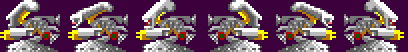 | 32×26 ×6 | 1 | 40 | 300 | `Upd_Cancer` | `Spawn_Cancer` | `$4BEA0` |
| `Def_Shell` |  | 32×27 ×8 | 1 | – | 200 | `Upd_Shell` | `Spawn_Shell` | `$4BF04` |
| `Def_Tabrok` |  | 48×43 ×5 | 30 | – | 800 | `Upd_Tabrok` | `Spawn_Tabrok` | `$4BFCA` |
| `Def_TabrokMissile` |  | 16×9 ×1 | 1 | – | – | `Upd_TabrokMissile` | – | `$4C036` |
| `Def_TabrokHomer` |  | 16×15 ×16 | 1 | – | – | `Upd_TabrokHomer` | – | `$4C068` |
| `Def_DobkeratopsTail` |  | 16×16 ×6 | 1 | – | – | `Upd_DobkeratopsTail` | `Spawn_DobkeratopsTail` | `$4C1CA` |
| `Def_DobkeratopsShot` |  | 32×21 ×8 | 1 | – | – | `Upd_DobkeratopsShot` | – | `$4C26C` |

## Level 2

| Label | Frames | Size | HP | Fires | Score | Update | Spawn | Address |
|---|---|---|---|---|---|---|---|---|
| `Def_Gouger` | 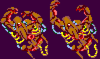 | 48×59 ×2 | 10 | – | 500 | `Upd_Gouger` | `Spawn_Gouger` | `$4AF24` |
| `Def_Wick` |  | 16×13 ×3 | 1 | – | 100 | `Upd_Wick` | `Spawn_Wick` | `$4AFA4` |
| `Def_WormHead` | 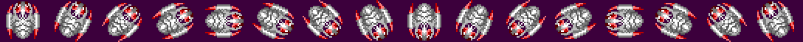 | 32×29 ×16 | – | – | 1000 | `Upd_Worm` | `Spawn_Worm` | `$4B1CC` |
| `Def_WormBody` | 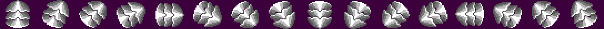 | 32×27 ×16 | – | – | 1000 | `Upd_Worm` | `Spawn_Worm` | `$4B296` |
| `Def_WormEye` | 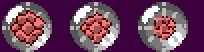 | 32×26 ×3 | – | – | 1000 | `Upd_Worm` | `Spawn_Worm` | `$4B33E` |
| `Def_Zoid` |  | 32×26 ×2 | – | – | 500 | `Upd_Zoid` | – | `$4B610` |

## Level 3

| Label | Frames | Size | HP | Fires | Score | Update | Spawn | Address |
|---|---|---|---|---|---|---|---|---|
| `Def_CoreOrb` |  | 16×10 ×4 | – | – | – | `Upd_CoreOrb` | `Spawn_CoreOrb` | `$4B80C` |
| `Def_GunTower` |  | 32×23 ×8 | – | – | 200 | `Upd_GunTower` | `Spawn_GunTower` | `$4B85A` |
| `Def_CannonPod` |  | 32×28 ×6 | – | – | 200 | `Upd_CannonPod` | `Spawn_CannonPod` | `$4B902` |
| `Def_Fireball` |  | 32×26 ×5 | – | – | – | `Upd_Fireball` | – | `$4B9CE` |
| `Def_MainEngine` | 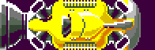 | 96×32 ×1 | – | – | 1000 | `Upd_MainEngine` | `Spawn_MainEngine` | `$4BB74` |
| `Def_EngineShot` |  | 16×14 ×2 | – | – | – | `Upd_EngineShot` | – | `$4BCAE` |
| `Def_TowerLaser` |  | 32×3 ×4 | – | – | – | `Upd_TowerLaser` | – | `$4BCEA` |

## Level 4

| Label | Frames | Size | HP | Fires | Score | Update | Spawn | Address |
|---|---|---|---|---|---|---|---|---|
| `Def_4B6F2` |  | 32×19 ×8 | 1 | 65 | 200 | `Upd_4AA4A` | `Spawn_4AA24` | `$4B6F2` |
| `Def_4B772` |  | 32×21 ×8 | 1 | 48 | 200 | `Upd_4AAC2` | `Spawn_4AA8A` | `$4B772` |
| `Def_4B7E4` | 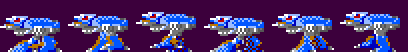 | 32×26 ×6 | 6 | – | 500 | `Upd_4AB3C` | `Spawn_4AB12` | `$4B7E4` |
| `Def_4B8A0` |  | 16×13 ×16 | – | – | – | `Upd_4AD22` | – | `$4B8A0` |
| `Def_4B95C` |  | 32×26 ×4 | 1 | 30 | 200 | `Upd_4AE04` | `Spawn_4ADC2` | `$4B95C` |
| `Def_4BA4A` |  | 32×26 ×6 | 1 | 40 | 300 | `Upd_4AF74` | `Spawn_4AF44` | `$4BA4A` |
| `Def_4BACE` | 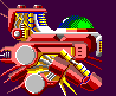 | 96×81 ×1 | – | – | – | `Upd_4B194` | – | `$4BACE` |
| `Def_4BAF6` |  | 112×58 ×1 | – | – | – | `Upd_4B194` | – | `$4BAF6` |
| `Def_4BB1E` | 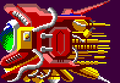 | 96×68 ×1 | – | – | – | `Upd_4B194` | – | `$4BB1E` |
| `Def_4BBAC` |  | 32×25 ×5 | – | – | – | `Upd_4B332` | – | `$4BBAC` |
| `Def_4BC5E` |  | 32×3 ×4 | – | – | – | `Upd_4B3BE` | – | `$4BC5E` |
| `Def_4BD08` | 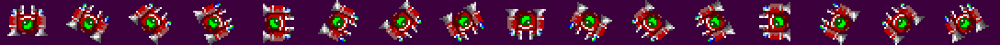 | 32×25 ×16 | 3 | – | 400 | `Upd_4B418` | `Spawn_4B3D0` | `$4BD08` |
| `Def_4BDC2` |  | 32×32 ×3 | 1 | – | 200 | `Upd_4B506` | `Spawn_4B4A6` | `$4BDC2` |

## Level 5

| Label | Frames | Size | HP | Fires | Score | Update | Spawn | Address |
|---|---|---|---|---|---|---|---|---|
| `Def_4B02C` |  | 32×26 ×6 | 1 | 34 | 300 | `Upd_4A838` | `Spawn_4A808` | `$4B02C` |
| `Def_4B0D0` | 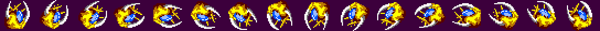 | 32×29 ×16 | – | – | 500 | `Upd_4A9F0` | `Spawn_4A928` | `$4B0D0` |
| `Def_4B18A` | 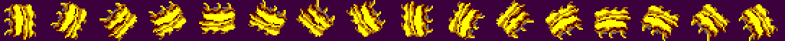 | 32×29 ×16 | – | – | 300 | `Upd_4A9F0` | `Spawn_4A928` | `$4B18A` |
| `Def_4B232` |  | 32×23 ×16 | – | – | 300 | `Upd_4A9F0` | `Spawn_4A928` | `$4B232` |
| `Def_4B2DA` | 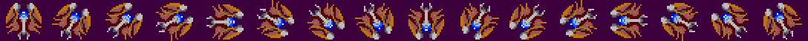 | 32×28 ×16 | – | 10 | 200 | `Upd_4ABA0` | `Spawn_4AB76` | `$4B2DA` |
| `Def_4B3D4` |  | 32×3 ×4 | – | – | – | `Upd_4ACEE` | – | `$4B3D4` |
| `Def_4B422` |  | 48×41 ×4 | – | – | 800 | `Upd_4AC86` | `Spawn_4AC10` | `$4B422` |
| `Def_4B452` |  | 32×20 ×8 | – | – | 400 | `Upd_4AC8E` | `Spawn_4AC36` | `$4B452` |
| `Def_4B5F8` | 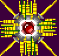 | 48×48 ×1 | – | – | 1000 | `Upd_4AD94` | `Spawn_4AD00` | `$4B5F8` |
| `Def_4B628` |  | 32×28 ×2 | – | – | 500 | `Upd_4AF14` | `Spawn_4AD00` | `$4B628` |

## Level 6

| Label | Frames | Size | HP | Fires | Score | Update | Spawn | Address |
|---|---|---|---|---|---|---|---|---|
| `Def_4ADBC` |  | 48×32 ×3 | – | – | 1000 | `Upd_4A9EE` | `Spawn_4A9B0` | `$4ADBC` |
| `Def_4AE1E` |  | 32×26 ×4 | 1 | 9 | 200 | `Upd_4AB08` | `Spawn_4AAC6` | `$4AE1E` |
| `Def_4AEFE` |  | 32×26 ×5 | – | – | 300 | `Upd_4AC8E` | `Spawn_4AC70` | `$4AEFE` |

## Level 7

| Label | Frames | Size | HP | Fires | Score | Update | Spawn | Address |
|---|---|---|---|---|---|---|---|---|
| `Def_4B884` |  | 32×19 ×8 | 1 | 45 | 200 | `Upd_4A94E` | `Spawn_4A928` | `$4B884` |
| `Def_4B8F6` |  | 32×21 ×8 | 1 | 95 | 200 | `Upd_4A9D0` | `Spawn_4A98E` | `$4B8F6` |
| `Def_4B968` |  | 32×26 ×6 | 6 | – | 500 | `Upd_4AA52` | `Spawn_4AA28` | `$4B968` |
| `Def_4BA24` |  | 16×13 ×16 | – | – | – | `Upd_4AC38` | – | `$4BA24` |
| `Def_4BAE0` |  | 48×47 ×3 | 30 | – | 500 | `Upd_4AD08` | `Spawn_4ACD8` | `$4BAE0` |
| `Def_4BB24` |  | 48×16 ×2 | – | – | – | – | – | `$4BB24` |
| `Def_4BB60` |  | 32×26 ×4 | 1 | 30 | 200 | `Upd_4AF1E` | `Spawn_4AEDC` | `$4BB60` |
| `Def_4BC10` |  | 32×26 ×6 | 1 | 40 | 300 | `Upd_4B08E` | `Spawn_4B05E` | `$4BC10` |
| `Def_4BC70` | 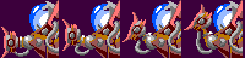 | 48×48 ×4 | – | – | – | `Upd_4B2FE` | – | `$4BC70` |
| `Def_4BCF6` |  | 32×31 ×4 | – | – | 100 | `Upd_4B2C4` | – | `$4BCF6` |
| `Def_4BE14` |  | 48×51 ×9 | indestructible | – | – | `Upd_4B42C` | `Spawn_4B3EC` | `$4BE14` |
| `Def_4BFA8` | 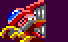 | 32×21 ×1 | – | – | 300 | `Upd_4B4FC` | `Spawn_4B4E2` | `$4BFA8` |
| `Def_4BFDA` | 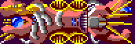 | 96×32 ×1 | – | – | 1500 | `Upd_4B55C` | `Spawn_4B534` | `$4BFDA` |
| `Def_4C00A` |  | 32×3 ×4 | – | – | – | `Upd_4B68C` | – | `$4C00A` |
| `Def_4C058` |  | 32×20 ×8 | – | – | 400 | `Upd_4B640` | `Spawn_4B60C` | `$4C058` |
| `Def_4C0EA` |  | 32×47 ×9 | – | – | 100 | `Upd_4B774` | – | `$4C0EA` |

## Level 8

| Label | Frames | Size | HP | Fires | Score | Update | Spawn | Address |
|---|---|---|---|---|---|---|---|---|
| `Def_4AA4C` |  | 32×14 ×4 | – | – | – | `Upd_4A8A8` | – | `$4AA4C` |
| `Def_4AA78` | 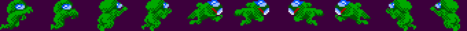 | 32×23 ×10 | – | – | 200 | `Upd_4A61A` | – | `$4AA78` |
| `Def_4AC04` |  | 32×30 ×6 | – | – | – | – | – | `$4AC04` |
| `Def_4B020` |  | 32×24 ×3 | – | – | – | `Upd_4A906` | `Spawn_4A8BE` | `$4B020` |
