# R-Type (Amiga) – object gallery

Every object definition found in the level files, with all its frames (level palette, 2× size). Generated by `tools/object_gallery.py`; labels match the sources (`Def_xxxxx` in `src/levels/levelN.s`). The engine's own definitions (explosions, walker, power-ups) are in `gfx/engine_bobs.png`.

The **Name** column is for the R-Type enemy names. Add them to `NAMES` in the script and rerun.

## Level 1

| Label | Frames | Size | HP | Fires | Score | Update | Spawn | Name |
|---|---|---|---|---|---|---|---|---|
| `Def_4B99A` |  | 32×19 ×8 | 1 | 60 | 200 | `$4A774` | `$4A74E` |  |
| `Def_4BA36` |  | 32×21 ×8 | 1 | 45 | 200 | `$4A7EC` | `$4A7B4` |  |
| `Def_4BAA8` |  | 32×26 ×6 | 6 | – | 500 | `$4A866` | `$4A83C` |  |
| `Def_4BB64` |  | 16×13 ×16 | – | – | – | `$4AA4C` | – |  |
| `Def_4BD02` | 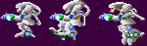 | 48×47 ×3 | 30 | – | 500 | `$4AC1C` | `$4ABF0` |  |
| `Def_4BD46` |  | 48×16 ×2 | – | – | – | – | – |  |
| `Def_4BD82` |  | 32×26 ×4 | 1 | 30 | 200 | `$4AE32` | `$4ADF0` |  |
| `Def_4BEA0` |  | 32×26 ×6 | 1 | 40 | 300 | `$4AFA2` | `$4AF72` |  |
| `Def_4BF04` |  | 32×27 ×8 | 1 | – | 200 | `$4B0D8` | `$4B080` |  |
| `Def_4BFCA` | 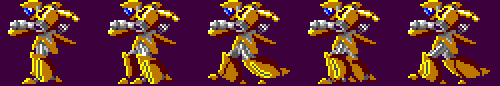 | 48×43 ×5 | 30 | – | 800 | `$4B22E` | `$4B1FC` |  |
| `Def_4C036` |  | 16×9 ×1 | 1 | – | – | `$4B480` | – |  |
| `Def_4C068` |  | 16×15 ×16 | 1 | – | – | `$4B3F0` | – |  |
| `Def_4C1CA` |  | 16×16 ×6 | 1 | – | – | `$4B632` | `$4B5C2` |  |
| `Def_4C26C` |  | 32×21 ×8 | 1 | – | – | `$4B874` | – |  |

## Level 2

| Label | Frames | Size | HP | Fires | Score | Update | Spawn | Name |
|---|---|---|---|---|---|---|---|---|
| `Def_4AF24` |  | 48×59 ×2 | 10 | – | 500 | `$4A578` | `$4A538` |  |
| `Def_4AFA4` |  | 16×13 ×3 | 1 | – | 100 | `$4A6AE` | `$4A638` |  |
| `Def_4B1CC` |  | 32×29 ×16 | – | – | 1000 | `$4AA08` | `$4A99C` |  |
| `Def_4B296` |  | 32×27 ×16 | – | – | 1000 | `$4AA08` | `$4A99C` |  |
| `Def_4B33E` |  | 32×26 ×3 | – | – | 1000 | `$4AA08` | `$4A99C` |  |
| `Def_4B610` | 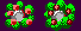 | 32×26 ×2 | – | – | 500 | `$4AD7C` | – |  |

## Level 3

| Label | Frames | Size | HP | Fires | Score | Update | Spawn | Name |
|---|---|---|---|---|---|---|---|---|
| `Def_4B80C` |  | 16×10 ×4 | – | – | – | `$4AADC` | `$4AA96` |  |
| `Def_4B85A` | 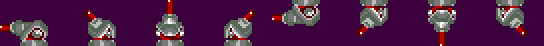 | 32×23 ×8 | – | – | 200 | `$4ABBC` | `$4AB40` |  |
| `Def_4B902` | 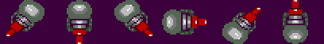 | 32×28 ×6 | – | – | 200 | `$4AC2C` | `$4AB7C` |  |
| `Def_4B9CE` |  | 32×26 ×5 | – | – | – | `$4ADC2` | – |  |
| `Def_4BB74` |  | 96×32 ×1 | – | – | 1000 | `$4AE78` | `$4AE26` |  |
| `Def_4BCAE` |  | 16×14 ×2 | – | – | – | `$4B060` | – |  |
| `Def_4BCEA` |  | 32×3 ×4 | – | – | – | `$4B1A4` | – |  |

## Level 4

| Label | Frames | Size | HP | Fires | Score | Update | Spawn | Name |
|---|---|---|---|---|---|---|---|---|
| `Def_4B6F2` |  | 32×19 ×8 | 1 | 65 | 200 | `$4AA4A` | `$4AA24` |  |
| `Def_4B772` |  | 32×21 ×8 | 1 | 48 | 200 | `$4AAC2` | `$4AA8A` |  |
| `Def_4B7E4` |  | 32×26 ×6 | 6 | – | 500 | `$4AB3C` | `$4AB12` |  |
| `Def_4B8A0` |  | 16×13 ×16 | – | – | – | `$4AD22` | – |  |
| `Def_4B95C` |  | 32×26 ×4 | 1 | 30 | 200 | `$4AE04` | `$4ADC2` |  |
| `Def_4BA4A` |  | 32×26 ×6 | 1 | 40 | 300 | `$4AF74` | `$4AF44` |  |
| `Def_4BACE` |  | 96×81 ×1 | – | – | – | `$4B194` | – |  |
| `Def_4BAF6` | 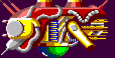 | 112×58 ×1 | – | – | – | `$4B194` | – |  |
| `Def_4BB1E` |  | 96×68 ×1 | – | – | – | `$4B194` | – |  |
| `Def_4BBAC` | 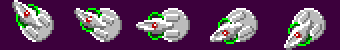 | 32×25 ×5 | – | – | – | `$4B332` | – |  |
| `Def_4BC5E` |  | 32×3 ×4 | – | – | – | `$4B3BE` | – |  |
| `Def_4BD08` |  | 32×25 ×16 | 3 | – | 400 | `$4B418` | `$4B3D0` |  |
| `Def_4BDC2` |  | 32×32 ×3 | 1 | – | 200 | `$4B506` | `$4B4A6` |  |

## Level 5

| Label | Frames | Size | HP | Fires | Score | Update | Spawn | Name |
|---|---|---|---|---|---|---|---|---|
| `Def_4B02C` |  | 32×26 ×6 | 1 | 34 | 300 | `$4A838` | `$4A808` |  |
| `Def_4B0D0` |  | 32×29 ×16 | – | – | 500 | `$4A9F0` | `$4A928` |  |
| `Def_4B18A` |  | 32×29 ×16 | – | – | 300 | `$4A9F0` | `$4A928` |  |
| `Def_4B232` |  | 32×23 ×16 | – | – | 300 | `$4A9F0` | `$4A928` |  |
| `Def_4B2DA` |  | 32×28 ×16 | – | 10 | 200 | `$4ABA0` | `$4AB76` |  |
| `Def_4B3D4` |  | 32×3 ×4 | – | – | – | `$4ACEE` | – |  |
| `Def_4B422` | 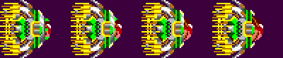 | 48×41 ×4 | – | – | 800 | `$4AC86` | `$4AC10` |  |
| `Def_4B452` |  | 32×20 ×8 | – | – | 400 | `$4AC8E` | `$4AC36` |  |
| `Def_4B5F8` |  | 48×48 ×1 | – | – | 1000 | `$4AD94` | `$4AD00` |  |
| `Def_4B628` | 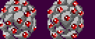 | 32×28 ×2 | – | – | 500 | `$4AF14` | `$4AD00` |  |

## Level 6

| Label | Frames | Size | HP | Fires | Score | Update | Spawn | Name |
|---|---|---|---|---|---|---|---|---|
| `Def_4ADBC` |  | 48×32 ×3 | – | – | 1000 | `$4A9EE` | `$4A9B0` |  |
| `Def_4AE1E` |  | 32×26 ×4 | 1 | 9 | 200 | `$4AB08` | `$4AAC6` |  |
| `Def_4AEFE` | 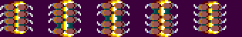 | 32×26 ×5 | – | – | 300 | `$4AC8E` | `$4AC70` |  |

## Level 7

| Label | Frames | Size | HP | Fires | Score | Update | Spawn | Name |
|---|---|---|---|---|---|---|---|---|
| `Def_4B884` |  | 32×19 ×8 | 1 | 45 | 200 | `$4A94E` | `$4A928` |  |
| `Def_4B8F6` |  | 32×21 ×8 | 1 | 95 | 200 | `$4A9D0` | `$4A98E` |  |
| `Def_4B968` |  | 32×26 ×6 | 6 | – | 500 | `$4AA52` | `$4AA28` |  |
| `Def_4BA24` |  | 16×13 ×16 | – | – | – | `$4AC38` | – |  |
| `Def_4BAE0` | 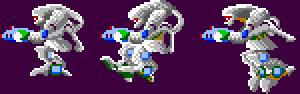 | 48×47 ×3 | 30 | – | 500 | `$4AD08` | `$4ACD8` |  |
| `Def_4BB24` |  | 48×16 ×2 | – | – | – | – | – |  |
| `Def_4BB60` |  | 32×26 ×4 | 1 | 30 | 200 | `$4AF1E` | `$4AEDC` |  |
| `Def_4BC10` |  | 32×26 ×6 | 1 | 40 | 300 | `$4B08E` | `$4B05E` |  |
| `Def_4BC70` |  | 48×48 ×4 | – | – | – | `$4B2FE` | – |  |
| `Def_4BCF6` | 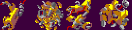 | 32×31 ×4 | – | – | 100 | `$4B2C4` | – |  |
| `Def_4BE14` |  | 48×51 ×9 | indestructible | – | – | `$4B42C` | `$4B3EC` |  |
| `Def_4BFA8` |  | 32×21 ×1 | – | – | 300 | `$4B4FC` | `$4B4E2` |  |
| `Def_4BFDA` |  | 96×32 ×1 | – | – | 1500 | `$4B55C` | `$4B534` |  |
| `Def_4C00A` |  | 32×3 ×4 | – | – | – | `$4B68C` | – |  |
| `Def_4C058` |  | 32×20 ×8 | – | – | 400 | `$4B640` | `$4B60C` |  |
| `Def_4C0EA` | 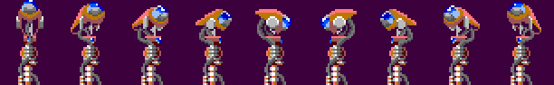 | 32×47 ×9 | – | – | 100 | `$4B774` | – |  |

## Level 8

| Label | Frames | Size | HP | Fires | Score | Update | Spawn | Name |
|---|---|---|---|---|---|---|---|---|
| `Def_4AA4C` |  | 32×14 ×4 | – | – | – | `$4A8A8` | – |  |
| `Def_4AA78` |  | 32×23 ×10 | – | – | 200 | `$4A61A` | – |  |
| `Def_4AC04` |  | 32×30 ×6 | – | – | – | – | – |  |
| `Def_4B020` |  | 32×24 ×3 | – | – | – | `$4A906` | `$4A8BE` |  |
