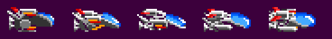
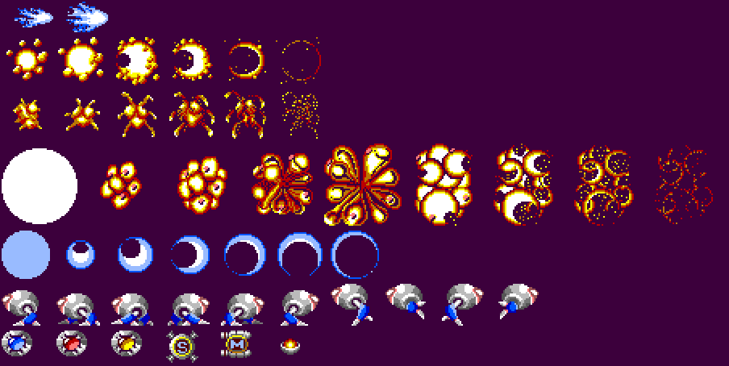
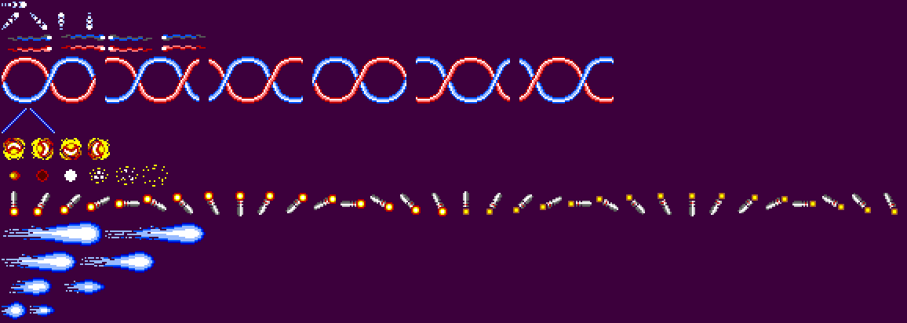

# Rendered graphics

Generated from `../files/` by `python3 -I tools/render_gfx.py files gfx` (run in `original/`). Formats are explained in [`../docs/GRAPHICS.md`](../docs/GRAPHICS.md).

- `levelN_map.png`: the full level map (level 3 is the giant battleship)
- `levelN_tiles.png`: the level's tile set, 16 per row
- `levelN_bobs.png`: enemy/object frames, one row per object definition
- `levelN_flags.png`: the map with its cell flags (red solid, yellow destructible, cyan animated)
- `objects/`: one picture per object definition, for `docs/OBJECTS.md` (`tools/object_gallery.py`)
- `hud.png`, `font_digits.png`, `font_game.png`: the HUD and the fonts (`tools/render_hud.py`)
- `sprites_ship.png`, `sprites_bits.png`, `sprites_force0-3.png`: hardware sprites from the `$6000` block (3× size)
- `engine_bobs.png`: the engine's shared BOBs: explosions, ring burst, speed-up flash, POW Armor (power-up carrier), power-up items
- `engine_weapons.png`: shots, the three lasers (anti-air, reflect, ground), enemy bullets, homing missiles, wave cannon sizes

- `hud.png`: the HUD as in memory and filled in (score, lives, beam meter); `font_game.png`, `font_digits.png`: the text and score fonts (`tools/render_hud.py`)
- `levelN_flags.png`: each map with its cell flags marked (red solid, yellow destructible, cyan animated)
