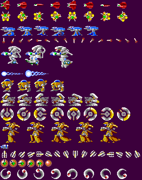

# Rendered graphics

Generated from `../files/` by `python3 -I tools/render_gfx.py files gfx` (run in `original/`). Formats are explained in [`../docs/GRAPHICS.md`](../docs/GRAPHICS.md).

- `levelN_map.png`: the full level map (level 3 is the giant battleship)
- `levelN_tiles.png`: the level's tile set, 16 per row
- `levelN_bobs.png`: enemy/object frames, one row per object definition
- `sprites_ship.png`, `sprites_bits.png`, `sprites_force0-3.png`: hardware sprites from the `$6000` block (3× size)
- `engine_bobs.png`: the engine's shared BOBs: explosions, ring burst, speed-up flash, cannon walker, power-up items

